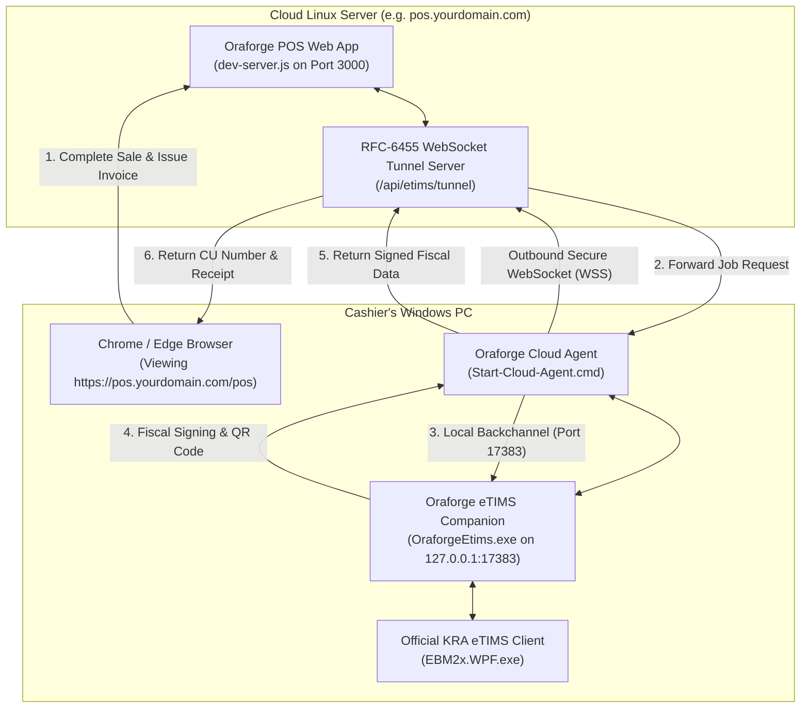

# Cloud Linux Deployment with Local Windows eTIMS Helper (Option 1: WebSocket Tunnel)

This guide explains how to host the **Oraforge POS** application on a remote cloud Linux server (AWS, DigitalOcean, Hetzner, VPS, Docker, etc.) while allowing cashiers to generate and sign official **KRA eTIMS invoices** seamlessly through their local Windows machine.

---

## 1. How It Works (Architecture)



### Why This Architecture Wins
- **100% KRA Compliance**: The official KRA eTIMS software (`EBM2x.WPF.exe`) and cryptographic keys remain safely on the local Windows PC at the hardware store or retail counter.
- **No Inbound Open Ports**: The cashier machine makes an *outbound* WebSocket connection to the cloud. You **do not need public IP addresses, port forwarding, or router access** on the client shop.
- **Zero CORS / Mixed Content Errors**: The browser communicates only with `https://pos.yourdomain.com`. The cloud server relays everything internally over the encrypted WebSocket tunnel.
- **Zero Client NPM Install**: The agent uses Node's native built-in modules (`http`, `crypto`, and RFC-6455 WebSocket) and can run directly using the bundled `runtime\node.exe` or system Node.

---

## 2. Cloud Server Setup (Linux VPS / Ubuntu / Debian)

### Prerequisites
- Node.js 18+ or Node.js 20+ installed on the Linux server.
- The repository cloned or copied to your server (e.g. `/var/www/pos`).

### Step 1: Install Dependencies
```bash
cd /var/www/pos/capacitor
npm install --omit=dev
```

### Step 2: Systemd Service (Auto-restart)
Create `/etc/systemd/system/oraforge-pos.service`:
```ini
[Unit]
Description=Oraforge POS Web Application
After=network.target

[Service]
Type=simple
User=www-data
WorkingDirectory=/var/www/pos/capacitor
ExecStart=/usr/bin/node dev-server.js
Restart=always
RestartSec=5
Environment=PORT=3000
Environment=POS_DESKTOP=0
# Optional: Set a secret token to protect the cashier tunnel
# Environment=ETIMS_TUNNEL_SECRET=your_secret_passphrase

[Install]
WantedBy=multi-user.target
```
Enable and start the service:
```bash
sudo systemctl daemon-reload
sudo systemctl enable --now oraforge-pos
sudo systemctl status oraforge-pos
```

### Step 3: Nginx Reverse Proxy with WebSocket Support
Configure your Nginx site (`/etc/nginx/sites-available/pos.yourdomain.com`):
```nginx
server {
    listen 80;
    server_name pos.yourdomain.com;
    return 301 https://$host$request_uri;
}

server {
    listen 443 ssl http2;
    server_name pos.yourdomain.com;

    ssl_certificate /etc/letsencrypt/live/pos.yourdomain.com/fullchain.pem;
    ssl_certificate_key /etc/letsencrypt/live/pos.yourdomain.com/privkey.pem;

    # 1. WebSocket Tunnel Endpoint for Cashier Agent
    location /api/etims/tunnel {
        proxy_pass http://127.0.0.1:3000;
        proxy_http_version 1.1;
        proxy_set_header Upgrade $http_upgrade;
        proxy_set_header Connection "Upgrade";
        proxy_set_header Host $host;
        proxy_set_header X-Real-IP $remote_addr;
        proxy_read_timeout 86400s;
        proxy_send_timeout 86400s;
    }

    # 2. Web POS Frontend & REST APIs
    location / {
        proxy_pass http://127.0.0.1:3000;
        proxy_http_version 1.1;
        proxy_set_header Host $host;
        proxy_set_header X-Real-IP $remote_addr;
        proxy_set_header X-Forwarded-For $proxy_add_x_forwarded_for;
        proxy_set_header X-Forwarded-Proto $scheme;
    }
}
```
Reload Nginx:
```bash
sudo nginx -t && sudo systemctl reload nginx
```

---

## 3. Cashier Windows PC Setup

### Step 1: Start the Local eTIMS Companion
Ensure `OraforgeEtims.exe` (or the Windows eTIMS helper) is running locally as usual and logged into the KRA client (`EBM2x.WPF.exe`).

### Step 2: Start the Cloud Agent
On the cashier's Windows machine:
1. Double-click **`Start-Cloud-Agent.cmd`** in the POS folder.
2. The agent will prompt for configuration on first run:
   ```
   Cloud POS Server URL: https://pos.yourdomain.com
   Shop identifier [retail]: retail
   ```
3. The agent verifies the local helper on `127.0.0.1:17383` and dials into the cloud server:
   ```
   ============================================================
     🟢 TUNNEL CONNECTED TO CLOUD POS
     Cashiers can now complete sales and generate KRA invoices!
   ============================================================
   ```

### Step 3: Configure as a Startup Task (Optional)
To have the agent launch automatically whenever Windows starts:
1. Press `Win + R`, type `shell:startup`, and press Enter.
2. Create a shortcut to `Start-Cloud-Agent.cmd` in the Startup folder.

---

## 4. Diagnostics & Verification

### Check Tunnel Status from Any Browser
Visit:
```
https://pos.yourdomain.com/api/etims/tunnel/status
```
Example response:
```json
{
  "app": "oraforge-pos",
  "platform": "linux",
  "tunnel_agents": [
    {
      "shopId": "retail",
      "remoteAddress": "197.237.15.42",
      "connectedAt": "2026-10-20T13:50:26.942Z"
    }
  ],
  "server_time": "2026-10-20T13:50:29.314Z"
}
```

### Multi-Shop / Multi-Till Setup
If the business operates multiple shops or multiple cash registers:
- **Shop A (Hardware Counter)**: Run with `--shop hardware`
- **Shop B (Timber Yard)**: Run with `--shop yard`

In the POS web application, when the cashier switches to the active shop, invoice requests automatically route to that specific cashier counter's local eTIMS helper.
